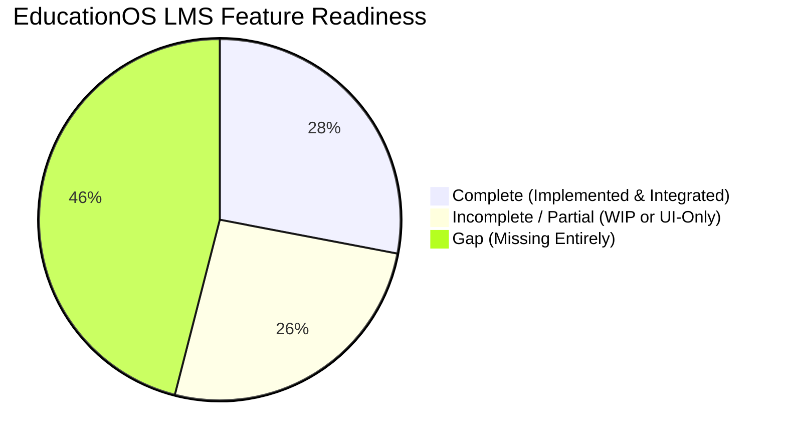

# EducationOS (EOS) vs. LMS Core Features Gap Analysis

**Document Code:** DOC-18  
**Scope:** Education Operating System (EOS) Monorepo vs. Industry Standard LMS Feature Specifications  
**Status:** Living Architecture & Audit Specification  

---

## Executive Summary

This document establishes a comprehensive baseline audit comparing the **Education Operating System (EOS)** codebase against the 14 Core Feature Categories of a modern enterprise Learning Management System (LMS).

EOS is engineered as a Clean Architecture, Domain-Driven Design (DDD) modular monolith with multi-tenant data isolation, Neon Cloud PostgreSQL, Fastify REST APIs, Cloudflare R2 object storage with HLS adaptive bitrate video transcoding, and a Next.js 16 App Router frontend.

### Summary Metrics

| Total Sub-Features Assessed | Complete (Ready) | Incomplete (Partial / Basic) | Gap (Not Built) |
| :---: | :---: | :---: | :---: |
| **14 Categories (62 items)** | **17 (28%)** | **16 (26%)** | **29 (46%)** |

---

## High-Level Status by Category

| Category | Status Overview | Implemented Strengths | Primary Gaps |
| :--- | :---: | :--- | :--- |
| **1. User & Role Management** | 🟡 **Partial** | Multi-tenant RBAC, JWT + refresh sessions, tenant & org membership | No SSO/OAuth2/SAML, no CSV bulk import, basic roles only |
| **2. Course Creation & Management** | 🟡 **Partial** | Course wizard, modules, HLS video, PDFs, public storefront catalog | No drag-and-drop builder, no SCORM/xAPI/LTI, no course cloning |
| **3. Content Delivery & Learning** | 🟡 **Partial** | HLS adaptive streaming, bookmarks with video seek, auto-saving notes | No native mobile apps, no offline mode, no captions/transcripts |
| **4. Assessment & Evaluation** | 🟡 **Partial** | In-lesson MCQ quiz submission & auto-grading | No question banks, no essays/file uploads, no proctoring, no gradebook |
| **5. Progress Tracking & Reporting** | 🟡 **Partial** | Lesson completion tracking, student & admin dashboards | No exportable/scheduled reports, no predictive analytics |
| **6. Communication & Collaboration** | ❌ **Major Gap** | Transactional emails via background worker outbox | No discussion forums, no internal chat, no Zoom/Meet integration |
| **7. Engagement & Gamification** | ❌ **Major Gap** | Dashboard UI trophy & badge icons | No backend gamification engine, no points ledger, no certificates |
| **8. Certification & Compliance** | ❌ **Major Gap** | Basic credit tracking on courses | No automated PDF certificates, no expiry/recertification |
| **9. Administration & Configuration** | ✅ **Substantial** | Multi-tenant branding, custom hex palettes, subdomain routing | No automated course approval workflows, no app-level backups |
| **10. Integrations & Interoperability** | ❌ **Major Gap** | Cloudflare R2, Resend email provider | No LTI/SCORM, no SIS/CRM/HRIS webhooks or public API keys |
| **11. E-Commerce & Monetization** | 🟡 **Partial** | Public catalog pricing, course preview storefront | No Stripe/PayPal integration, no subscriptions or coupon codes |
| **12. Security, Privacy & Compliance** | ✅ **Substantial** | Scoped RBAC, httpOnly cookies, CSRF protection, hashed tokens | No GDPR data export/erasure tools, no IP allowlisting |
| **13. Accessibility & Inclusivity** | 🟡 **Partial** | High-contrast dark mode, semantic Tailwind elements | No WCAG 2.1 audit, no VTT closed captions, no RTL support |
| **14. Performance, Scalability & Support**| 🟡 **Partial** | Clean Architecture DDD, FFmpeg ABR, Postgres SKIP LOCKED | No multi-region clustering, no ticketing helpdesk |

---

## Detailed Comparative Breakdown

### 1. User & Role Management

| Sub-Feature | Status | Evidence in Codebase | Notes / Gaps |
| :--- | :---: | :--- | :--- |
| **Multiple roles** | 🟡 **Incomplete** | `packages/infrastructure/database/src/schema/auth.schema.js` seeded with `ADMIN`, `INSTRUCTOR`, `STUDENT`. | Missing explicit `MANAGER` and `GUEST` permission bundles. |
| **Role-based access control (RBAC)** | ✅ **Complete** | `roleAssignmentsTable`, `authorize.js` middleware. | Fine-grained permissions resolved dynamically per request. |
| **User registration & self-enrollment** | ✅ **Complete** | `/api/v1/public/auth/register`, 1-click enroll in `/enrollments` (`academics.js`). | Students can self-register or be provisioned via storefront. |
| **Bulk import (CSV)** | ❌ **Gap** | None found. | No CSV parser or batch user creation endpoint. |
| **SSO, social login, MFA** | ❌ **Gap** | Auth is username/password with bcrypt. | No OAuth2 (Google, GitHub), SAML, or 2FA/TOTP. |
| **Groups, cohorts, departments** | 🟡 **Incomplete** | `batchesTable`, `organizationsTable`, `userTenantMembershipsTable`. | Supports cohort batches and branch organizations, but lacks nested department trees. |
| **Personal profiles & dashboards** | ✅ **Complete** | `users.js` (`/api/v1/internal/users/profile`), `apps/web/app/dashboard/page.js`. | Profile editing (timezone, language, phone, avatar) & dual-mode dashboards. |

---

### 2. Course Creation & Management

| Sub-Feature | Status | Evidence in Codebase | Notes / Gaps |
| :--- | :---: | :--- | :--- |
| **Course builder with drag-and-drop** | 🟡 **Incomplete** | `course-creation-wizard.jsx`, `apps/web/app/dashboard/courses/[id]/page.js`. | Reordering is done via increment/decrement buttons; drag-and-drop UX is not yet built. |
| **Multiple content types (SCORM, xAPI, LTI, etc.)** | 🟡 **Incomplete** | Supports `VIDEO` (HLS/MP4), `DOCUMENT` (PDF), and `QUIZ`. | **Gap:** No runtime or player for SCORM 1.2/2004, xAPI, cmi5, H5P, or LTI 1.3. |
| **Content library & reusable objects** | 🟡 **Incomplete** | `media_assets` table & Cloudflare R2 uploads. | Media is stored globally, but there is no centralized asset browser across courses. |
| **Course templates and cloning** | ❌ **Gap** | None found. | No clone/duplicate endpoint for courses or syllabi. |
| **Versioning, drafts, scheduled publishing** | 🟡 **Incomplete** | `status` (`DRAFT`, `ACTIVE`, `ARCHIVED`) and `version` column in `coursesTable`. | No scheduled release timer or diff/branch version control. |
| **Prerequisites & learning paths** | ❌ **Gap** | None found. | No course prerequisite validation or sequential course dependencies. |
| **Course catalog with search & tags** | ✅ **Complete** | `/catalog/page.js`, `/storefront/:slug` public endpoints. | Catalog with search, level filters, credit display, and branch aggregations. |
| **Multilingual content support** | 🟡 **Incomplete** | `language` column on `courses` (defaults to `'en'`). | No multi-language translation management or alternate audio tracks. |

---

### 3. Content Delivery & Learning Experience

| Sub-Feature | Status | Evidence in Codebase | Notes / Gaps |
| :--- | :---: | :--- | :--- |
| **Responsive web interface** | ✅ **Complete** | Next.js 16 App Router + Tailwind v4 + Drawer menus. | Fully responsive across mobile, tablet, and desktop viewports. |
| **Native mobile apps** | ❌ **Gap** | Only a promotional web banner exists. | No React Native, Flutter, iOS, or Android apps. |
| **Offline access & progress sync** | ❌ **Gap** | None found. | No Service Worker caching, IndexedDB offline store, or background sync. |
| **Video streaming (HLS, controls, captions)** | 🟡 **Incomplete** | `apps/worker/src/services/transcoder.js`, `HlsVideoPlayer.jsx`. | Multi-bitrate HLS (360p, 720p, 1080p). **Gap:** No WebVTT closed captions or transcripts. |
| **Self-paced & cohort-based modes** | ✅ **Complete** | Cohort batches (`batchesTable`) and self-paced lesson player. | Students can complete modules on their own or within a designated term batch. |
| **Bookmarks, notes, resume playback** | ✅ **Complete** | `lessonNotesTable`, `lessonBookmarksTable`, `learning.js`. | Auto-saving notes with debounce + timestamped video bookmarks with 1-click seek. |
| **Adaptive recommendations & AI** | ❌ **Gap** | None found. | No recommendation engine or dynamic learning path adjustment. |
| **Microlearning support** | 🟡 **Incomplete** | Chapter timeline splits and modular 5–15 min lessons. | No spaced-repetition scheduler or daily micro-nudge push notifications. |

---

### 4. Assessment & Evaluation

| Sub-Feature | Status | Evidence in Codebase | Notes / Gaps |
| :--- | :---: | :--- | :--- |
| **Quizzes & exams (various question types)** | 🟡 **Incomplete** | `SubmitQuizUseCase.js`, `quizSubmissionsTable`. | Supports Multiple Choice Questions (MCQ). **Gap:** No essay, fill-in-the-blank, or matching. |
| **Question banks with randomization** | ❌ **Gap** | Quizzes are stored directly as JSON in `lesson_modules`. | No standalone question repository or randomized question draws. |
| **Timed tests, attempt limits, proctoring** | ❌ **Gap** | None found. | No countdown timer enforcement, attempt locks, or proctoring SDKs. |
| **Assignment submission & file uploads** | ❌ **Gap** | Uploads exist for instructor course assets only. | No student homework upload or assignment dropboxes. |
| **Rubrics and grading scales** | ❌ **Gap** | None found. | Fixed percentage pass/fail only (`passingScore = 70`). |
| **Auto-grading & manual grading** | 🟡 **Incomplete** | MCQ auto-grading in `apps/api/src/routes/v1/internal/learning.js`. | Manual instructor grading interface and grading queue are missing. |
| **Peer review, self-assessment, surveys** | ❌ **Gap** | None found. | No peer review workflows or survey modules. |
| **Gradebook with weighted grading** | ❌ **Gap** | None found. | No instructor gradebook table or weighted term grades. |

---

### 5. Progress Tracking & Reporting

| Sub-Feature | Status | Evidence in Codebase | Notes / Gaps |
| :--- | :---: | :--- | :--- |
| **Learner progress & completion tracking** | ✅ **Complete** | `studentProgressTable`, `/courses/:id/progress`. | Real-time percentage calculation and completion checkmarks per lesson. |
| **Time-spent & engagement analytics** | 🟡 **Incomplete** | Analytics cards on dashboard; `lastActiveAt` on memberships. | No granular session duration logging or video watch-time telemetry. |
| **Custom, scheduled, exportable reports** | ❌ **Gap** | None found. | No CSV/PDF report generation or automated report scheduling. |
| **Dashboards (learners, instructors, admins)**| ✅ **Complete** | Dedicated student classroom and admin/instructor portals in `apps/web/app/dashboard/page.js`. | Full switcher for managing courses vs. tracking active student enrollments. |
| **Skills gap & competency tracking** | ❌ **Gap** | None found. | No competency framework or skill taxonomy. |
| **Predictive insights (at-risk detection)** | ❌ **Gap** | None found. | No automated heuristic or ML model to flag inactive students. |

---

### 6. Communication & Collaboration

| Sub-Feature | Status | Evidence in Codebase | Notes / Gaps |
| :--- | :---: | :--- | :--- |
| **Discussion forums & Q&A boards** | ❌ **Gap** | None found. | No discussion threads, comments, or lesson Q&A boards. |
| **Announcements & internal messaging** | ❌ **Gap** | None found. | No campus announcement feed or direct student-instructor messaging. |
| **Email, SMS, push notifications** | 🟡 **Incomplete** | `ResendMailProvider.js` via outbox queue. | Supports activation emails, enrollment invites, password reset. **Gap:** No SMS or Web Push. |
| **Live chat & chatbot support** | ❌ **Gap** | None found. | No live chat widget or AI learning assistant. |
| **Virtual classroom (Zoom, Teams, Meet)** | ❌ **Gap** | None found. | No webinar or teleconference webhooks. |
| **Wikis, shared documents, group work** | ❌ **Gap** | None found. | No collaborative doc editor or group project workspace. |
| **Calendar and event scheduling** | 🟡 **Incomplete** | Schedule sidebar component on dashboard. | Display-only UI; lacks recurring calendar event engine or iCal/.ics sync. |

---

### 7. Engagement & Gamification

| Sub-Feature | Status | Evidence in Codebase | Notes / Gaps |
| :--- | :---: | :--- | :--- |
| **Badges, points, leaderboards** | 🟡 **Incomplete** | Trophy & badge UI components in dashboard. | No backend points ledger, badge award rules, or cohort leaderboards. |
| **Certificates & digital credentials** | ❌ **Gap** | None found. | No certificate PDF generator, verification hash, or Open Badges API. |
| **Social learning (likes, shares, comments)** | ❌ **Gap** | None found. | No social interactions or community activity feeds. |
| **Learner feedback & course ratings** | ❌ **Gap** | None found. | No 5-star rating schema or student review collection. |

---

### 8. Certification & Compliance

| Sub-Feature | Status | Evidence in Codebase | Notes / Gaps |
| :--- | :---: | :--- | :--- |
| **Automated certificate generation** | ❌ **Gap** | None found. | No HTML/PDF rendering canvas for diplomas. |
| **Expiry, recertification, renewal alerts**| ❌ **Gap** | None found. | No expiration dates or recertification cron tasks. |
| **Continuing education (CE/CPD) credits** | 🟡 **Incomplete** | `credits` integer field on `coursesTable`. | Stores academic credits, but lacks formal CPD accreditation reporting. |
| **Audit trails and activity logs** | 🟡 **Incomplete** | Audit columns (`createdAt`, `createdBy`, `updatedAt`, `version`). | Missing a dedicated, immutable security event audit log table. |
| **Compliance training escalation** | ❌ **Gap** | None found. | No overdue compliance reminders or managerial escalation triggers. |

---

### 9. Administration & Configuration

| Sub-Feature | Status | Evidence in Codebase | Notes / Gaps |
| :--- | :---: | :--- | :--- |
| **Centralized admin console** | ✅ **Complete** | `/dashboard/courses`, `/dashboard/students`, `/dashboard/tenants`. | Comprehensive management of curriculum, student roster, and campuses. |
| **Branding & white-labeling** | ✅ **Complete** | Dynamic theme engine, custom hex palettes, `apps/web/app/dashboard/settings/page.js`. | Real-time CSS variable injection based on active tenant branding. |
| **Multi-tenancy for institutions** | ✅ **Complete** | `tenantsTable`, `apps/web/proxy.js` subdomain proxy. | Isolated data partitions per institution with `{slug}.localhost:3000` routing. |
| **Automated enrollment notifications** | ✅ **Complete** | Outbox `EnrollmentCreated` event triggers worker email with activation token. | Automated transactional email delivery upon student addition. |
| **Course approval workflows** | ❌ **Gap** | None found. | No multi-step approval workflow (e.g., Instructor -> Dean -> Published). |
| **Language & localization settings** | 🟡 **Incomplete** | Stored in user profile and course metadata. | No UI internationalization dictionary (e.g. `next-intl` or `i18next`). |
| **Backup, restore, retention policies** | 🟡 **Incomplete** | Relies on Neon Cloud Postgres automated continuous backups. | No self-service admin UI for snapshot export or custom data retention. |

---

### 10. Integrations & Interoperability

| Sub-Feature | Status | Evidence in Codebase | Notes / Gaps |
| :--- | :---: | :--- | :--- |
| **Open APIs & webhooks** | 🟡 **Incomplete** | RESTful Fastify API with modular routes. | **Gap:** No public developer API keys, OpenAPI/Swagger UI, or outgoing webhooks. |
| **HR systems (HRIS), SIS, CRM** | ❌ **Gap** | None found. | No sync connectors for Workday, Banner, Canvas SIS, or Salesforce. |
| **Content marketplaces & libraries** | ❌ **Gap** | None found. | No import connectors for Coursera, Udemy, or LinkedIn Learning. |
| **Plagiarism detection** | ❌ **Gap** | None found. | No integration with Turnitin, Copyleaks, or Unicheck. |
| **Standards (SCORM, xAPI, LTI, QTI)** | ❌ **Gap** | None found. | Complete gap on e-learning interoperability standards. |

---

### 11. E-Commerce & Monetization

| Sub-Feature | Status | Evidence in Codebase | Notes / Gaps |
| :--- | :---: | :--- | :--- |
| **Course pricing & public storefront** | ✅ **Complete** | `storefront/:slug/courses`, `apps/web/app/catalog/page.js`. | Displays course prices, credits, curriculum outlines, and preview videos. |
| **Payment gateway (Stripe, PayPal)** | ❌ **Gap** | `billing.recurring` is a skeleton queue job in `apps/worker/src/processors/index.js`. | Checkout currently uses instant mock enrollment; no active Stripe SDK. |
| **Bundles, coupons, subscriptions** | ❌ **Gap** | None found. | No discount codes, course bundles, or recurring membership plans. |
| **Invoicing & tax handling** | ❌ **Gap** | None found. | No VAT/GST calculation or downloadable PDF tax invoices. |
| **Affiliate & reseller management** | ❌ **Gap** | None found. | No referral links or affiliate revenue sharing. |

---

### 12. Security, Privacy & Compliance

| Sub-Feature | Status | Evidence in Codebase | Notes / Gaps |
| :--- | :---: | :--- | :--- |
| **Data encryption (in transit & at rest)** | ✅ **Complete** | Neon Cloud TLS/Postgres at rest, Bcrypt password hashing, SHA-256 tokens. | Modern cryptographic defaults across authentication and storage. |
| **Session security & CSRF protection** | ✅ **Complete** | `authCookies.js`, rotating refresh tokens in `user_sessions`. | httpOnly cookies for web + double-submit CSRF cookie + Bearer header for API. |
| **GDPR / FERPA / HIPAA Compliance** | 🟡 **Incomplete** | Soft-delete columns (`deletedAt`, `deletedBy`) exist across all models. | Missing self-service GDPR "export my data" or "delete account" flows. |
| **Architecture security & static audits** | ✅ **Complete** | `.dependency-cruiser.js`, strict boundary rules, clean architecture enforcement. | Automated linting and architecture verification in CI/commit hooks. |
| **IP restrictions & session kill-switch** | 🟡 **Incomplete** | Sessions store `ipAddress` and `userAgent`; single-device logout implemented. | Missing organization-level CIDR IP allowlisting or bulk session termination. |

---

### 13. Accessibility & Inclusivity

| Sub-Feature | Status | Evidence in Codebase | Notes / Gaps |
| :--- | :---: | :--- | :--- |
| **WCAG 2.1 Compliance** | 🟡 **Incomplete** | Clean semantic HTML, Radix UI accessible headless primitives. | No formal WCAG 2.1 AA audit or screen-reader test report. |
| **Dark mode & high-contrast themes** | ✅ **Complete** | Tailwind dark-mode classes with seamless client switching. | Full light/dark mode support with high-contrast borders and palettes. |
| **Captions & audio descriptions** | ❌ **Gap** | None found. | Video pipeline does not generate or display WebVTT subtitle tracks. |
| **Right-to-Left (RTL) language support** | ❌ **Gap** | None found. | Missing `dir="rtl"` layout styles for Arabic/Hebrew. |

---

### 14. Performance, Scalability & Support

| Sub-Feature | Status | Evidence in Codebase | Notes / Gaps |
| :--- | :---: | :--- | :--- |
| **Scalable micro-architecture** | ✅ **Complete** | Modular Monolith (Clean Architecture + DDD bounded contexts). | Clean domain boundaries allow splitting into microservices when needed. |
| **High-throughput background jobs** | ✅ **Complete** | `outbox_events` with `SKIP LOCKED` worker dequeuing. | Decoupled asynchronous video encoding and transactional email dispatch. |
| **Media delivery scalability** | ✅ **Complete** | Cloudflare R2 object storage + presigned upload URLs. | Large media files bypass API servers and stream directly from CDN. |
| **Built-in help center & tutorials** | 🟡 **Incomplete** | Onboarding timeline and `/docs` system architecture reference. | No interactive product tour or end-user FAQ/knowledge base. |
| **Customer support (chat/tickets)** | ❌ **Gap** | Display-only `supportEmail` in tenant settings. | No integrated ticketing helpdesk or live support chat. |

---

## Prioritized Implementation Roadmap

### Phase 1: Core Pedagogical Enhancements
1. **Assignments & Submissions:** Create an `assignments` table, student file dropzone, and instructor grading view.
2. **Gradebook:** Build weighted assessment scoring aggregated into a student transcript.
3. **Question Variety:** Extend quiz engine beyond MCQs to include short answers and true/false.

### Phase 2: Community & Retention
1. **Discussion & Q&A:** Implement lesson-level comments and campus announcements.
2. **Certificates:** Render verifiable completion certificates via Puppeteer or SVG canvas.

### Phase 3: Commercial & Standards Readiness
1. **Payment Gateway:** Integrate Stripe Elements for paid course checkout on tenant storefronts.
2. **Interoperability:** Build an LTI 1.3 / SCORM runner for importing third-party course packages.
3. **Accessibility:** Generate automated WebVTT subtitles during video transcoding.
